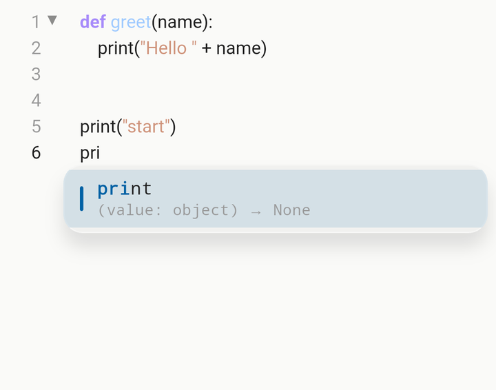
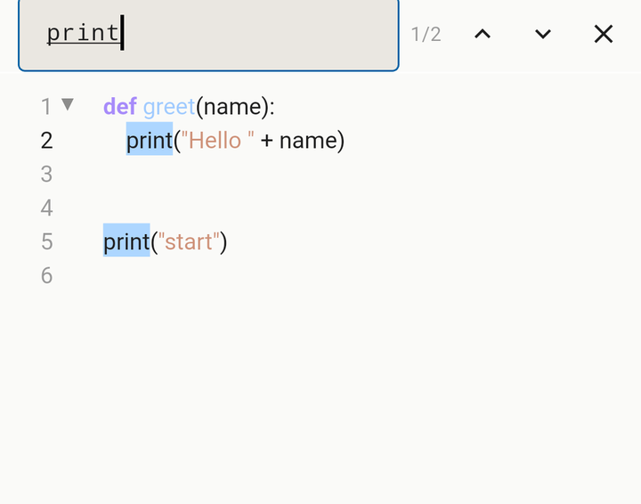

# nova_editor

A focused code-editing surface for Flutter, built directly on
[`re_editor`](https://pub.dev/packages/re_editor).

`nova_editor` owns the pieces an application would otherwise re-implement on
top of `re_editor`: the gutter, indentation-aware folding, the completion popup
and its input policy, the find bar and a diagnostics strip. It never reads app
state, providers or platform channels, so it can be tested and reused on its
own.

| Completion | Find |
| --- | --- |
|  |  |

## Features

- **One document model.** The `CodeLineEditingController` you pass in is the
  only copy of the text, selection and composing range.
- **Tap-only completion.** Suggestions are applied only when a row is tapped.
  Enter always inserts a newline, including while the soft keyboard is
  composing, and IME composition is never interrupted.
- **Readable popup.** A fixed-width list with a kind colour, typed-prefix
  highlighting, `(params) → return` detail for functions and a type line for
  fields. It is LTR even in RTL apps, so identifiers are not cut mid-word.
- **Folding.** Indentation-based chunk analysis for Python-style languages
  (and YAML), with a chevron column that only reacts on foldable lines.
- **Find bar.** A compact search bar over `re_editor`'s find controller, with a
  match counter, previous/next and close.
- **Diagnostics strip.** Error/warning/info markers that track document lines
  through folded blocks.
- **Theming.** One `NovaEditorTheme` value carries colours and token styles;
  there is no global state.

## Getting started

```yaml
dependencies:
  nova_editor: ^0.1.0
```

The editor is a normal widget. Create a controller and a theme, then give the
editor a language:

```dart
import 'package:flutter/material.dart';
import 'package:nova_editor/nova_editor.dart';
import 'package:re_editor/re_editor.dart';
import 'package:re_highlight/languages/python.dart';

class EditorPage extends StatefulWidget {
  const EditorPage({super.key});

  @override
  State<EditorPage> createState() => _EditorPageState();
}

class _EditorPageState extends State<EditorPage> {
  final CodeLineEditingController _controller =
      CodeLineEditingController.fromText('print("hello")\n');
  final CodeFindController _find = CodeFindController(_controller);

  @override
  void dispose() {
    _find.dispose();
    _controller.dispose();
    super.dispose();
  }

  @override
  Widget build(BuildContext context) {
    return Scaffold(
      appBar: AppBar(
        actions: <Widget>[
          IconButton(
            icon: const Icon(Icons.search),
            onPressed: _find.findMode,
          ),
        ],
      ),
      body: NovaEditor(
        controller: _controller,
        theme: const NovaEditorTheme(
          background: Color(0xFF0D1117),
          foreground: Color(0xFFE6EDF3),
          cursor: Color(0xFF7EE787),
          selection: Color(0x337EE787),
          lineNumber: Color(0xFF6E7681),
          accent: Color(0xFF58A6FF),
          tokens: <String, TextStyle>{
            'root': TextStyle(color: Color(0xFFE6EDF3)),
            'keyword': TextStyle(color: Color(0xFFFF7B72)),
            'string': TextStyle(color: Color(0xFFA5D6FF)),
          },
        ),
        languageId: 'python',
        highlightMode: langPython,
        findController: _find,
        promptsBuilder: DefaultCodeAutocompletePromptsBuilder(
          language: langPython,
        ),
      ),
    );
  }
}
```

A complete example lives in [`example/`](example/).

### Async completions

`re_editor` only re-evaluates the prompt builder on text input. If an LSP
server or an AI provider adds suggestions while the user is idle, pass a
`Listenable` as `completionRefresh` and notify it when the list changes. The
package keeps the overlay mounted (with an empty value) so an async result can
appear without waiting for the next keystroke.

### Custom input policy

`NovaImeController` wraps a controller to hide `isComposing` from `re_editor`
while keeping the real composing range in the value. Use it when a soft
keyboard keeps a composition open for a whole word and you still want the
completion popup to stay visible.

## Compatibility

- Dart `^3.13.3`, Flutter `>=3.41.0`
- `re_editor ^0.10.0`

## License

Released under the [Waqf General Public License, Version 1](LICENSE) — a copyleft
license that lifts the restrictions on copying and redistribution while
preserving attribution. The license text is in Arabic, with an English summary
at the top of the file.
